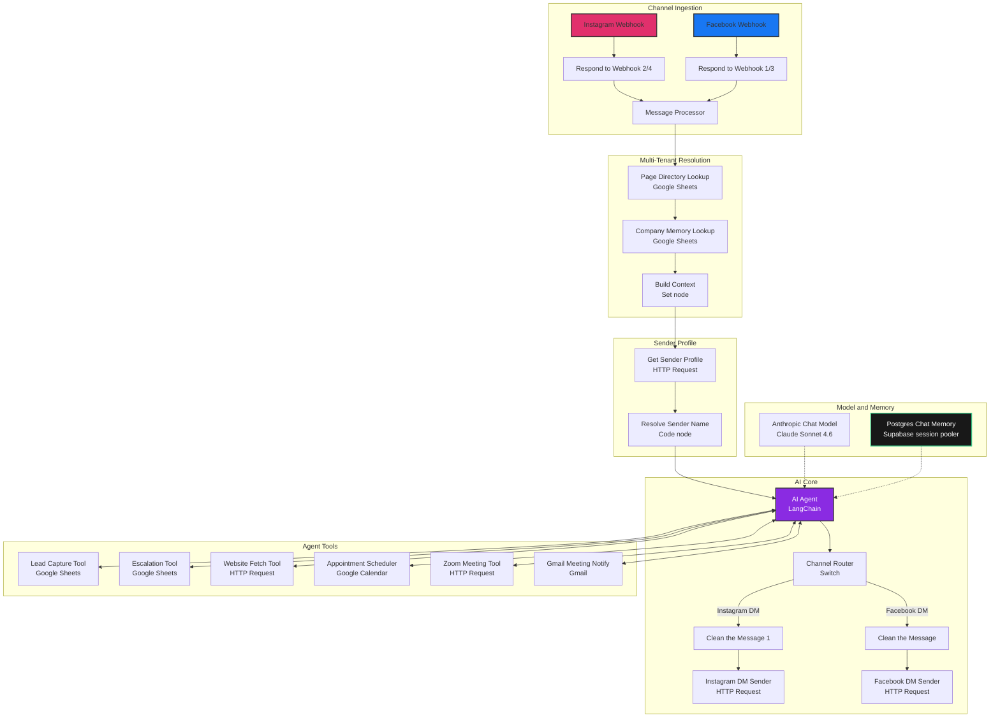
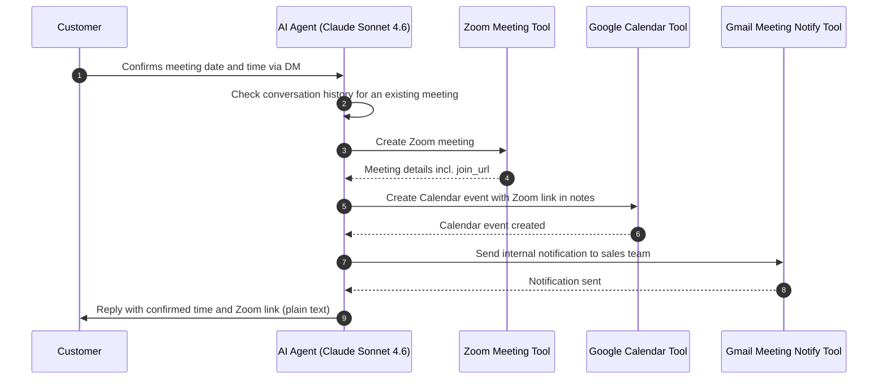

<div align="center">

# Multi-Tenant Media Response Agent

**AI-powered Instagram & Facebook DM automation: multi-tenant social media response with persistent memory, lead qualification, and automated meeting scheduling.**

<br />

<p align="center">
  
</p>

<p align="center">
  <a href="https://n8n.io/">
    
  </a>
  <a href="https://www.anthropic.com/">
    
  </a>
  <a href="https://www.postgresql.org/">
    
  </a>
  <a href="https://supabase.com/">
    
  </a>
  <a href="https://www.instagram.com/">
    
  </a>
  <a href="https://www.facebook.com/">
    
  </a>
  <a href="https://zoom.us/">
    
  </a>
  <a href="https://calendar.google.com/">
    
  </a>
  <a href="https://sheets.google.com/">
    
  </a>
  <a href="https://mail.google.com/">
    
  </a>
</p>

</div>

---

## Why this exists

Real-estate investing brands running social media campaigns face fragmented inboxes across Instagram DMs and Facebook messages/comments. Leads fall through the cracks, replies are repetitive, and meeting booking is manual and error-prone, including duplicate Zoom links when conversation context is lost between restarts.

This n8n workflow solves it with a **multi-tenant AI response agent**: every incoming event is resolved to a `company_id`, company-specific context is injected into Claude Sonnet 4.6's system prompt from Google Sheets, and the agent handles replies, lead capture, escalation, and end-to-end Zoom + Google Calendar meeting booking with persistent conversation memory on Supabase.

Built for Reihand.

---

## Feature grid

| Feature | Description |
|---|---|
| Multi-tenant isolation | Each event resolves to a `company_id`; only that company's context is injected, never another tenant's data |
| Context-aware replies | Company config (brand identity, services, offers, brand voice, FAQ, escalation rules, restricted topics, language mode) injected into the AI system prompt |
| Lead qualification | AI classifies leads as `potential`, `qualified`, or `not_qualified` with reasoning, captured to Google Sheets |
| Human escalation | Conversations flagged for escalation are logged to a dedicated escalation sheet with a reason |
| Automated meeting scheduling | Zoom meeting created, Google Calendar event with Zoom link, internal Gmail notification, customer confirmation |
| Persistent memory | Postgres Chat Memory on Supabase with session key `company_id_platform_senderId`, context window 20 |
| Social-safe formatting | Markdown stripped from replies; URLs protected; plain-text output for Instagram/Facebook DMs |

---

## Architecture

The node graph below is derived from the exported workflow. Webhooks ingest Instagram and Facebook events, a processor normalizes them, tenant context is looked up from Google Sheets, and the LangChain AI agent orchestrates replies and tool calls with persistent memory.



### Meeting-booking sequence



---

## Project structure

```
Multi-Tenant Media Response Agent/
├── Agent 6 _ Media Response Agent.json   # n8n workflow export (credentials removed)
└── README.md                             # This file
```

---

## Engineering highlights

### Persistent memory migration

**Problem:** The original in-process Simple Memory lost conversation history when the workflow was saved, re-activated or n8n restarted. Returning users were treated as new, causing "Welcome!" re-greetings and duplicate Zoom meeting creation.

**Root cause:** Simple Memory is held in the n8n process memory and is not a persistent store.

**Fix:** Replaced with **Postgres Chat Memory** backed by Supabase (session pooler). Session key: `company_id_platform_senderId`. Context window: 20. History now persists across restarts, so returning customers are recognized and existing meetings are not duplicated.

### Duplicate-meeting prevention

Before creating a Zoom meeting, the agent checks the conversation history loaded from Postgres memory. If a meeting already exists for this user, it returns the existing details and asks whether the request is the same meeting, a reschedule, or a new separate meeting. This is enforced at the prompt level; a tool-level guard is on the roadmap.

### Prompt condensing with preserved behavior

The agent's system prompt was condensed by roughly half (duplicate rules merged, repeated "do not append CTAs/promos" statements consolidated) while keeping the same behavior. A conversation-continuity rule and an existing-meeting rule were added on top.

### Company isolation

Strict `company_id` scoping is enforced at lookup time. The agent uses only information for the resolved `company_id`; it never guesses or invents company information and escalates when data is missing or restricted.

### Safe Zoom-failure fallback

If Zoom meeting creation fails, the agent does not invent a join URL. It tells the customer the meeting is noted, that the team will send the link shortly, and escalates via the Escalation Tool.

---

<details>
<summary>Node &amp; tool reference (generated from workflow JSON)</summary>

| Node | Type | Purpose |
|---|---|---|
| Instagram Webhook | n8n-nodes-base.webhook | Receives Instagram webhook events |
| Facebook Webhook | n8n-nodes-base.webhook | Receives Facebook webhook events |
| Respond to Webhook1 | n8n-nodes-base.respondToWebhook | Facebook webhook challenge response |
| Respond to Webhook2 | n8n-nodes-base.respondToWebhook | Instagram webhook challenge response |
| Respond to Webhook3 | n8n-nodes-base.respondToWebhook | Facebook webhook JSON acknowledgment |
| Respond to Webhook4 | n8n-nodes-base.respondToWebhook | Instagram webhook JSON acknowledgment |
| Message Processor | n8n-nodes-base.code | Parses webhook body into structured events (platform, sender, message, etc.) |
| Page Directory Lookup | n8n-nodes-base.googleSheets | Looks up page by platform + page_id to resolve company |
| Company Memory Lookup | n8n-nodes-base.googleSheets | Looks up company config by company_slug |
| Build Context | n8n-nodes-base.set | Builds context assignments fed into the AI agent prompt |
| Channel Router | n8n-nodes-base.switch | Routes to Instagram DM or Facebook DM based on platform + event_type |
| Clean the Message / Clean the Message1 | n8n-nodes-base.code | Strips Markdown, protects URLs, outputs plain text |
| Instagram DM Sender | n8n-nodes-base.httpRequest | Sends reply via Instagram Graph API |
| Facebook DM Sender | n8n-nodes-base.httpRequest | Sends reply via Facebook Graph API |
| AI Agent | @n8n/n8n-nodes-langchain.agent | LangChain agent orchestrating replies and tool calls |
| Anthropic Chat Model | @n8n/n8n-nodes-langchain.lmChatAnthropic | Claude Sonnet 4.6 language model |
| Postgres Chat Memory | @n8n/n8n-nodes-langchain.memoryPostgresChat | Persistent conversation memory on Supabase |
| Get Sender Profile | n8n-nodes-base.httpRequest | Fetches sender profile from Meta Graph API |
| Resolve Sender Name | n8n-nodes-base.code | Resolves real sender name from profile response |
| Lead Capture Tool | n8n-nodes-base.googleSheetsTool | Appends qualified lead data to the Lead_Capture sheet |
| Escalation Tool | n8n-nodes-base.googleSheetsTool | Appends escalation records to the Escalation sheet |
| Website Fetch Tool | n8n-nodes-base.httpRequestTool | Fetches company WordPress page content via REST API |
| Appointment Scheduler Tool | n8n-nodes-base.googleCalendarTool | Creates Google Calendar event with meeting details |
| Zoom Meeting Tool | n8n-nodes-base.httpRequestTool | Creates Zoom meeting via Zoom API |
| Gmail Meeting Notify Tool | n8n-nodes-base.gmailTool | Sends internal meeting notification email |
| Sticky Note10 | n8n-nodes-base.stickyNote | Workflow annotation |

</details>

---

## Setup guide

### Prerequisites

- n8n instance (self-hosted or n8n Cloud)
- Google Cloud project with Google Sheets, Google Calendar, and Gmail APIs enabled
- Meta app with Instagram and Facebook webhook permissions
- Zoom OAuth app
- Anthropic API account with Claude access
- Supabase project (PostgreSQL)

### Import the workflow

1. In n8n, choose **Import from file** and select the workflow JSON from this repo. All credentials were removed from the export.
2. Open each node that uses credentials and create the credential entries below.

### Credential types to create

| Credential type | Service | Fields to configure |
|---|---|---|
| googleSheetsOAuth2Api | Google Sheets | client id, client secret |
| googleCalendarOAuth2Api | Google Calendar | client id, client secret |
| zoomOAuth2Api | Zoom | account id, client id, client secret |
| gmailOAuth2 | Gmail | client id, client secret |
| anthropicApi | Anthropic | API key |
| postgres | PostgreSQL (Supabase) | host, port, database, user, password |

> **Note:** Credential names and values are intentionally omitted from this repo. Create them in the n8n UI and select them in each node's credentials panel.

### Google Sheets structure

Four sheets are referenced in the workflow. Create them in a single Google Sheet:

**Sheet 1: Page Directory** (lookup by `platform` + `page_id`)

| Column | Purpose |
|---|---|
| platform | instagram or facebook |
| page_id | Meta page / Instagram account ID |
| company_slug | Unique company identifier |
| page_access_token | Page access token for outbound replies |

**Sheet 2: Company Information** (lookup by `company_slug`)

| Column | Purpose |
|---|---|
| company_slug | Unique company identifier |
| business_name | Display name |
| assistant_name | Assistant name |
| website_url | Company website |
| services | Services offered |
| products | Products offered |
| target_audience | Target audience |
| faqs | FAQ knowledge |
| approved_answers | Approved response templates |
| lead_qualification_rules | Qualification rules |
| cta | Default call-to-action |
| contact_info | Contact information |
| escalation_rules | Escalation criteria |
| brand_voice | Brand tone/voice |
| language_mode | Response language |
| not_allowed | Restricted topics |
| leads_sheet_id | Linked leads sheet ID |
| calendar_id | Linked Google Calendar ID |

**Sheet 3: Lead_Capture** (append)

| Column | Source |
|---|---|
| lead_id | AI-generated unique ID |
| company_id | Resolved company ID |
| company_name | Company name |
| platform | instagram / facebook |
| sender_id | Customer sender ID |
| sender_name | Resolved sender name |
| message | Customer message |
| lead_status | potential / qualified / not_qualified |
| lead_reason | Qualification reasoning |
| property_address | Extracted from conversation |
| property_type | Extracted from conversation |
| asking_price | Extracted price |
| motivation | Seller motivation |
| timeline | Selling timeline |
| contact_information | Phone/email if provided |
| created_at | Timestamp |

**Sheet 4: Escalation** (append)

| Column | Purpose |
|---|---|
| escalation_id | Unique escalation ID |
| company_id | Resolved company ID |
| company_name | Company name |
| platform | instagram / facebook |
| sender_id | Customer sender ID |
| sender_name | Resolved sender name |
| message | Customer message |
| escalation_reason | AI-generated reason |
| status | pending |
| created_at | Timestamp |

### Supabase / Postgres setup

- In Supabase, open **Connect** and use the **Session pooler** connection details (port `5432`). The session pooler is IPv4-compatible; the direct connection is IPv6 only.
- In the n8n Postgres credential, set **SSL** to `Require` and keep **Maximum Number of Connections** small (for example `5`).
- Use the `postgres` credential type in n8n with the pooler host, database, user (`postgres.<project-ref>`) and your database password.
- The Postgres Chat Memory node uses the table `n8n_chat_histories`. It is created on first run; if it does not appear in Supabase, create it manually.
- Set the memory session key to `company_id_platform_senderId` (Session ID: Define below) with a context window of 20.

### Meta webhook configuration

1. Create a Meta app with **Instagram** and **Facebook** products.
2. Configure webhook subscriptions for `messages`, `messaging_postbacks`, and `comments`.
3. Set the callback URL to your n8n webhook endpoints:
   - Instagram webhook path: `/webhook/Instagram`
   - Facebook webhook path: `/webhook/facebook_debug`
4. Complete the challenge handshake (the n8n `Respond to Webhook` nodes handle `hub.challenge`).
5. Subscribe your app to the relevant Instagram/Facebook pages.

### Activate and test

1. Open the imported workflow in n8n.
2. Select credentials for every credential-bearing node.
3. Set the correct Google Sheet document ID and sheet names in each Google Sheets node.
4. **Activate** the workflow.
5. Send a test DM from Instagram and a test message/comment from Facebook.
6. Verify: context lookup, AI reply, DM sender delivery.
7. Test the meeting flow end-to-end (Zoom, Calendar, Gmail, confirmation).
8. Test a returning user to confirm memory persistence and no duplicate meeting creation.

### Test checklist

- [ ] Instagram webhook receives and responds to challenge
- [ ] Facebook webhook receives and responds to challenge
- [ ] Page Directory Lookup resolves company_id correctly
- [ ] Company Memory Lookup injects company context
- [ ] AI Agent replies with the correct brand voice
- [ ] Zoom meeting creation returns a valid join_url
- [ ] Google Calendar event includes the Zoom link
- [ ] Gmail notification is sent to the sales team
- [ ] Returning user is recognized (no "Welcome!" re-greeting)
- [ ] Duplicate meeting request returns the existing meeting
- [ ] Escalation logs to the Escalation sheet
- [ ] Lead capture logs to the Lead_Capture sheet

---

## Configuration reference

Configure the following in the n8n UI (credential types only, no values):

- `googleSheetsOAuth2Api`: Page Directory Lookup, Company Memory Lookup, Lead Capture Tool, Escalation Tool
- `googleCalendarOAuth2Api`: Appointment Scheduler Tool
- `zoomOAuth2Api`: Zoom Meeting Tool
- `gmailOAuth2`: Gmail Meeting Notify Tool
- `anthropicApi`: Anthropic Chat Model (Claude Sonnet 4.6)
- `postgres`: Postgres Chat Memory

---

## Example conversation

**Customer (Instagram DM):** Hi, I'm interested in selling my property. Can we schedule a call?

**Agent:** Thanks for reaching out! I'd be happy to help. What date and time work for you, and which time zone are you in?

**Customer:** Tomorrow at 2 PM, Bangladesh time.

**[Behind the scenes: Zoom meeting created, Calendar event created, Gmail notification sent to the sales team]**

**Agent:** You're all set. Your call is scheduled for tomorrow at 2:00 PM BDT (30 minutes). Zoom link: `https://zoom.us/j/<meeting-id>`

---

**[Later, same customer messages again]**

**Customer:** Hey, can we schedule a meeting?

**Agent:** You already have a meeting scheduled for tomorrow at 2:00 PM BDT. Is this the same meeting, would you like to reschedule it, or is this a new meeting about a different topic?

**[Behind the scenes: Postgres memory recognized `company_id_instagram_senderId`; no new Zoom meeting created]**

---

## Roadmap (planned)

- Tool-level duplicate meeting guard backed by a dedicated Meetings sheet in Google Sheets
- Webhook message-ID deduplication to prevent reprocessing the same event
- Reschedule and cancel flow for existing Zoom + Calendar meetings

All items above are **planned** and not yet implemented.

---

## Tech & Skills Showcase

### AI / Automation
<p align="left">
  
  
  
  
</p>

### Backend / Data
<p align="left">
  
  
  
  
</p>

### Integrations
<p align="left">
  
  
  
  
  
  
</p>

---

## Author

**[Your Name]**, AI Engineer
Multi-agent automation, LLM orchestration, n8n workflow engineering

[](https://github.com/TODO)
[](https://linkedin.com/in/TODO)
[](mailto:TODO)

---

> **Open to freelance automation work:** AI agents, n8n workflows, lead capture and meeting booking systems. Reach out via the links above.

---

<div align="center">


⭐ **Star this repo** if you found it useful

</div>
